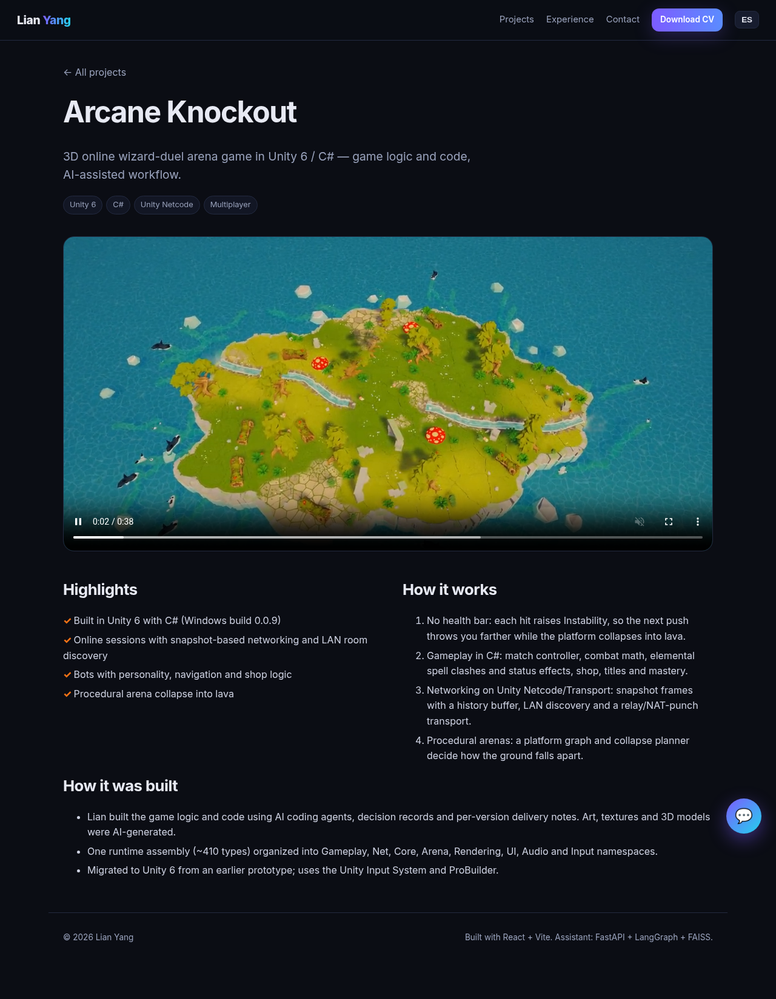
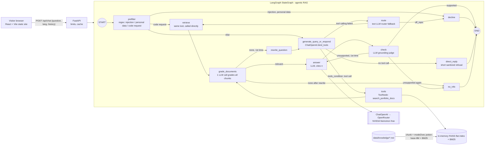

# Lian Yang — Developer Portfolio + AI Assistant

Bilingual (EN/ES) portfolio site with a **LangGraph** chatbot that answers recruiters' questions about Lian's projects, using only his documentation and citing sources.


| Project page | Chat (demo LLM) | Chat offline fallback |
|---|---|---|
|  |  |  |

## Architecture



- **Grounded answers:** the answer prompt allows only the numbered sources; a second LLM call checks the answer against them, retries once with stricter instructions, then declines ("I don't have that information").
- **Agentic RAG (official LangGraph tutorial pattern):** `generate_query_or_respond` binds the retriever as a LangChain `@tool` (`search_portfolio_docs`, `response_format="content_and_artifact"` so sources travel as the artifact); `tools_condition` sends tool calls to a `ToolNode`; `grade_documents` keeps only relevant chunks; if none, `rewrite_question` reformulates and loops back to the agent (max 1 rewrite). Differences from the tutorial: grading is one batched call (ids of relevant chunks) instead of one structured yes/no per document, a regex prefilter runs first, a grounding `check` follows the answer, and direct (no-tool) replies are sanitized to short refusals.
- **Tool-calling reliability:** Nemotron's tool calling worked in testing (it writes short English queries). If the provider/model rejects or fails tool calls, the graph falls back to a plain-text LLM router + direct retrieval (covered by tests).
- **LLM calls per question:** typical 4 (agent, grade, answer, check); max 8 (+ rewrite, agent again, regrade, one answer retry); 1 for off-topic (agent replies directly); 0 for regex-declined, precomputed or cached questions.
- **Routing:** cheap regex prefilter for obvious cases; the tool-calling agent decides everything else (e.g. "write me a calculator" gets a short refusal, not a code request).
- **Memory:** the browser sends the last 6 turns; used by the router, for follow-up retrieval and in the answer prompt.
- **Retrieval:** hybrid of BM25 (60%) and real semantic embeddings (40%) from [model2vec](https://github.com/MinishLab/model2vec) `minishlab/potion-base-8M` (static, ~30 MB, no torch) in a FAISS flat index. It is English-focused, so the agent writes English queries and BM25 keeps a small ES→EN expansion. The multilingual potion-128M (512 MB) and potion-retrieval-32M (~330 MB peak RSS) did not fit the 512 MB instance. Measured RSS: ~110 MB idle, ~195 MB peak after loading the model and answering (local uvicorn, `VmHWM`).
- **Pluggable LLM:** any OpenAI-compatible endpoint via env vars; `LLM_PROVIDER=fake` for demos/tests.
- **Agent trace:** every response includes `trace` (nodes executed, retrieved chunk titles + scores, grounding verdict) and the cited snippets; the widget shows them in a collapsible "Agent trace".
- **Cost limits:** questions ≤ 300 chars; history ≤ 6 turns × 500 chars; per-IP (X-Forwarded-For) 8 free questions/day + burst 3/min; global 40 LLM questions/day (`IP_DAILY`, `IP_BURST`, `GLOBAL_DAILY`). Suggested questions are precomputed once with the real graph (`python -m scripts.build_suggested` → `data/suggested.json`, also bundled in the frontend) and identical questions hit an in-memory LRU, so both cost 0 API calls. Limits are in-memory (single instance, reset on restart).
- **Prompt-injection hardening (not a guarantee):** regex prefilter for obvious attempts → polite refusal without calling the LLM; visitor text, history and documents are wrapped in `<user_question>`, `<conversation>`, `<document>` tags that system prompts declare as untrusted data, and tag look-alikes are stripped; the model never receives secrets (the API key only travels in the HTTP header); the model has no tools, so injected text can at worst change wording, which the grounding check then screens. It is not injection-proof.
- **Safe errors:** provider errors become a generic 502; keys never reach the browser or logs.
- **Graceful degradation:** if the backend is asleep or fails, that single message is answered by an in-browser keyword search, labeled as a no-AI fallback; the next message tries the backend again.

## Layout

```
frontend/   React + Vite site (hash routing, EN/ES toggle, CV download, chat widget)
  src/content.js       all bilingual content
  public/cv/           CV PDFs (EN/ES, web version: email + GitHub only)
  public/img/          screenshots (resized WebP)
backend/    FastAPI + LangGraph
  app/graph.py         StateGraph: prefilter → route → retrieve → answer → check
  app/kb.py            markdown chunking, BM25 + model2vec embeddings (FAISS flat index)
  app/llm.py           OpenAI-compatible client + FakeLLM
  data/knowledge/      the documents the assistant can cite
  tests/               pytest (fake LLM + hash embedder, no network)
screens/    headless screenshots
```

## Run locally

```bash
# backend
cd backend
python -m venv .venv && . .venv/bin/activate
pip install -r requirements-dev.txt
cp .env.example .env          # set LLM_API_KEY, or LLM_PROVIDER=fake
set -a; . ./.env; set +a
uvicorn app.main:app --port 8000
pytest -q

# frontend
cd frontend
npm install
VITE_API_URL=http://localhost:8000 npm run dev
npm run build                 # → dist/
```

To update what the assistant knows, edit `backend/data/knowledge/*.md` and restart.

## Deployment plan (not deployed yet)

**Frontend (static):**
- *GitHub Pages:* repo `CatbearLang/CatbearLang.github.io` (or any repo with Pages), build with `VITE_API_URL=https://<backend-host>` and publish `frontend/dist` via a GitHub Actions Pages workflow. `base: './'` + hash routing means no server rewrites are needed.
- *Vercel:* import the repo, root `frontend`, build `npm run build`, output `dist`, env `VITE_API_URL`.

**Backend (free tier):**
- *Render:* Web Service, root `backend`, build `pip install -r requirements.txt`, start `uvicorn app.main:app --host 0.0.0.0 --port $PORT`. Free instances sleep when idle (first request ~30–60 s); the widget's offline fallback covers that.
- *Hugging Face Spaces (Docker):* same command on port 7860; doesn't sleep as aggressively.
- Env vars on the host: `LLM_BASE_URL`, `LLM_API_KEY`, `LLM_MODEL`, `CORS_ORIGINS=<frontend URL>`.

**LLM options:** Groq free tier (`llama-3.1-8b-instant`, fast), OpenRouter free models, or Ollama for local use only.

## Author

**Lian Yang** · [GitHub](https://github.com/CatbearLang) · Catbeardarkworld@gmail.com
