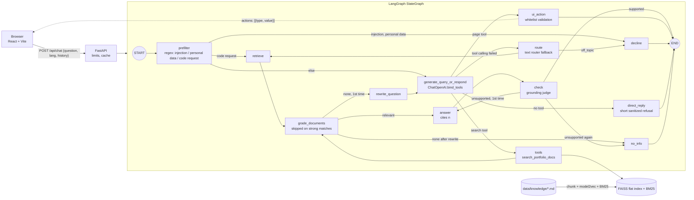

# Lian Yang — Developer Portfolio + AI Assistant

**Live site:** https://catbearlang.github.io/portfolio

Bilingual (EN/ES) portfolio with a **LangGraph** assistant that answers recruiters' questions from my project docs with cited sources, and **operates the page on request**: say "switch to dark mode", "open ELF Reader" or "take me to the contact section" and a cursor moves to the real control, highlights it and clicks it.

- Frontend: React + Vite, static on GitHub Pages (`frontend/`)
- Backend: FastAPI + LangGraph + LangChain, free Render instance, free LLM through OpenRouter (`backend/`)
- Tests ([CI](https://github.com/CatbearLang/portfolio/actions/workflows/ci.yml)): 47 backend tests (fake LLM, no network) + 24 frontend tests for the in-browser command matcher
- Evaluation: `backend/eval/questions.jsonl` (39 labeled questions) and `python -m scripts.eval`

## Architecture



### Page control (tool calling)

The agent has five page tools next to the search tool: `set_theme`, `set_language`, `go_to_section`, `open_project`, `download_cv` (`backend/app/page_actions.py`). The model only *proposes* actions; the server validates the tool name and argument against a whitelist (unknown tools and values are dropped, at most 3 per message) and returns `actions` to the browser. `frontend/src/pageActions.js` executes only those known types, on the real controls, with a visible cursor (instant when the visitor prefers reduced motion). A page command costs one LLM call and no retrieval.

When the free backend is asleep, still waking up or out of quota, `frontend/src/intents.js` matches the same commands in the browser (no LLM) and the chat says so. Plain questions ("how does GlosSub work?") are never turned into actions; `frontend/tests/intents.test.mjs` covers both sides.

### Retrieval and answers

- **Hybrid search:** BM25 (60%) + semantic embeddings (40%) from [model2vec](https://github.com/MinishLab/model2vec) `minishlab/potion-base-8M` (static, ~30 MB, no torch) in a FAISS flat index. Peak RSS about 195 MB measured locally, so it fits Render's 512 MB free instance.
- **Fixed score scale:** BM25 is squashed with `bm25 / (bm25 + 4)` instead of being divided by the best hit of each query. Before, every query's top hit looked perfect, so the minimum score filtered nothing; now `RETRIEVAL_MIN_SCORE` (0.25) drops weak matches, and a top hit at or above `SKIP_GRADE_SCORE` (0.6) skips the LLM grading call.
- **Grounded answers:** the answer prompt allows only the numbered sources; a second LLM call checks the answer, retries once with stricter instructions, then says "I don't have that information".
- **LLM calls per question:** 1 for page commands and off-topic messages; typically 3 to 4 for questions (agent, grade unless skipped, answer, check); max 8; 0 for regex-declined, precomputed or cached questions.
- **Agent trace:** every response includes `trace` (nodes, retrieved chunks with scores, grounding verdict) and the cited snippets; the widget shows them.

### Safety and cost limits

- Questions ≤ 300 characters; history ≤ 6 turns × 500 characters.
- Per visitor 8 questions/day + burst 3/min; global 40 LLM questions/day (`IP_DAILY`, `IP_BURST`, `GLOBAL_DAILY`). Limits are in memory (single instance, they reset when the free instance restarts).
- Visitor IP: taken from a header the hosting edge sets (`CLIENT_IP_HEADERS`, default `cf-connecting-ip`), else the `X-Forwarded-For` entry added by the nearest proxy (`TRUSTED_PROXY_HOPS`), never the leftmost entry, which the visitor can write. The server logs which source it used (not the IP).
- Prompt-injection hardening (not a guarantee): regex prefilter; visitor text, history and documents wrapped in tags the prompts treat as data; the model never sees secrets; read-only search and whitelisted page tools; grounding check.
- Suggested questions are precomputed once with the real graph (`python -m scripts.build_suggested`) and repeated questions hit an LRU cache: 0 API calls.
- Provider errors become a generic 502; keys never reach the browser or logs.
- The page pings `/api/health` on load, so the free server starts waking up while the visitor reads, and a scheduled workflow ([keep-awake](.github/workflows/keep-awake.yml)) pings it every 10 minutes so it rarely sleeps. The health endpoint never calls the model.

## Evaluation

`backend/eval/questions.jsonl` holds 39 labeled questions: 20 with the documents that answer them and the key facts the answer must contain, 3 the docs can't answer, 9 the assistant must decline (off-topic, prompt injection, secrets, personal data) with strings that must never appear, and 7 page commands. Grading is deterministic (regexes, citation check, graph output), with no LLM judge.

```bash
cd backend
python -m scripts.eval retrieval   # offline, no LLM: BM25 vs embeddings vs hybrid (hit@1, hit@3, MRR, AUC)
python -m scripts.eval models      # 16 questions through the real graph per model; spends free quota (capped)
```

Results go to `backend/eval/results/`. The retrieval run also happens on every backend pull request ([eval workflow](.github/workflows/eval.yml)). The model run is manual (Actions > Assistant evaluation > Run workflow) and needs the `OPENROUTER_API_KEY` repository secret; it uses at most 225 requests, one every 3.5 seconds, with retries off.

## Layout

```
frontend/   React + Vite site (hash routing, EN/ES, light/dark, CV download, chat widget)
  src/content.js       all bilingual content
  src/intents.js       in-browser command matching (fallback)
  src/pageActions.js   visible execution of whitelisted page actions
  src/Art.jsx          SVG project covers and the architecture diagram
  public/cv/           CV PDFs (EN/ES)
  public/img/          screenshots and media
backend/    FastAPI + LangGraph
  app/graph.py         StateGraph
  app/page_actions.py  page tools + whitelist validation
  app/kb.py            markdown chunking, BM25 + model2vec (FAISS)
  app/limits.py        quotas, client IP, answer cache
  data/knowledge/      the documents the assistant can cite
  eval/                labeled questions for scripts/eval.py
  tests/               pytest (fake LLM + hash embedder, no network)
```

## Run locally

```bash
# backend
cd backend
python -m venv .venv && . .venv/bin/activate
pip install -r requirements-dev.txt
cp .env.example .env          # set LLM_API_KEY and LLM_MODEL, or LLM_PROVIDER=fake
set -a; . ./.env; set +a
uvicorn app.main:app --port 8000
pytest -q

# frontend
cd frontend
npm install
npm test
VITE_API_URL=http://localhost:8000 npm run dev
npm run build                 # → dist/
```

To update what the assistant knows, edit `backend/data/knowledge/*.md` and restart.

## Deployment

- **Frontend:** GitHub Pages (`gh-pages` branch), built with `VITE_API_URL=<backend URL>`. `base: './'` + hash routing, so no server rewrites are needed.
- **Backend:** Render web service, root `backend`, build `pip install -r requirements.txt`, start `uvicorn app.main:app --host 0.0.0.0 --port $PORT`. Environment: `LLM_BASE_URL`, `LLM_API_KEY`, `LLM_MODEL`, `CORS_ORIGINS`, and optionally the variables in `backend/.env.example`. Free instances sleep after 15 minutes idle and take about a minute to wake up; the keep-awake workflow prevents most of that, and the widget's in-browser fallback covers the rest.

## Author

**Lian Yang** · [LinkedIn](https://www.linkedin.com/in/lianyang-dev) · [GitHub](https://github.com/CatbearLang) · Catbeardarkworld@gmail.com
