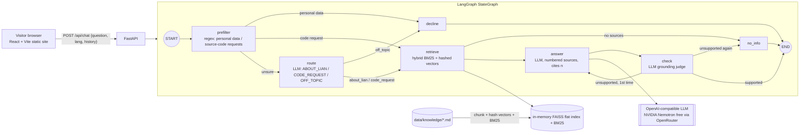

# Lian Yang — Developer Portfolio + AI Assistant

Bilingual (EN/ES) portfolio site with a **LangGraph** chatbot that answers recruiters' questions about Lian's projects, using only his documentation and citing sources.


| Project page | Chat (demo LLM) | Chat offline fallback |
|---|---|---|
|  |  |  |

## Architecture



- **Grounded answers:** the answer prompt allows only the numbered sources; a second LLM call checks the answer against them, retries once with stricter instructions, then declines ("I don't have that information").
- **Routing:** cheap regex prefilter for obvious cases, LLM router for everything else (e.g. "write me a calculator" is off-topic, not a code request).
- **Memory:** the browser sends the last 6 turns; used by the router, for follow-up retrieval and in the answer prompt.
- **Retrieval:** hybrid of BM25 (60%) and hashed bag-of-words vectors in a FAISS flat index (40%). No neural embedding model on the free 512 MB instance (`EMBEDDER=fastembed` is optional locally).
- **Pluggable LLM:** any OpenAI-compatible endpoint via env vars; `LLM_PROVIDER=fake` for demos/tests.
- **Safe errors:** provider errors become a generic 502; keys never reach the browser or logs.
- **Graceful degradation:** if the backend is asleep or fails, that single message is answered by an in-browser keyword search, labeled as a no-AI fallback; the next message tries the backend again.

## Layout

```
frontend/   React + Vite site (hash routing, EN/ES toggle, CV download, chat widget)
  src/content.js       all bilingual content
  public/cv/           CV PDFs (EN/ES, web version: email + GitHub only)
  public/img/          screenshots (resized WebP)
backend/    FastAPI + LangGraph
  app/graph.py         StateGraph: prefilter → route → retrieve → answer → check
  app/kb.py            markdown chunking, BM25 + hashed vectors (FAISS flat index)
  app/llm.py           OpenAI-compatible client + FakeLLM
  data/knowledge/      the documents the assistant can cite
  tests/               pytest (fake LLM + hash embedder, no network)
screens/    headless screenshots
```

## Run locally

```bash
# backend
cd backend
python -m venv .venv && . .venv/bin/activate
pip install -r requirements-dev.txt
cp .env.example .env          # set LLM_API_KEY, or LLM_PROVIDER=fake
set -a; . ./.env; set +a
uvicorn app.main:app --port 8000
pytest -q

# frontend
cd frontend
npm install
VITE_API_URL=http://localhost:8000 npm run dev
npm run build                 # → dist/
```

To update what the assistant knows, edit `backend/data/knowledge/*.md` and restart.

## Deployment plan (not deployed yet)

**Frontend (static):**
- *GitHub Pages:* repo `CatbearLang/CatbearLang.github.io` (or any repo with Pages), build with `VITE_API_URL=https://<backend-host>` and publish `frontend/dist` via a GitHub Actions Pages workflow. `base: './'` + hash routing means no server rewrites are needed.
- *Vercel:* import the repo, root `frontend`, build `npm run build`, output `dist`, env `VITE_API_URL`.

**Backend (free tier):**
- *Render:* Web Service, root `backend`, build `pip install -r requirements.txt`, start `uvicorn app.main:app --host 0.0.0.0 --port $PORT`. Free instances sleep when idle (first request ~30–60 s); the widget's offline fallback covers that.
- *Hugging Face Spaces (Docker):* same command on port 7860; doesn't sleep as aggressively.
- Env vars on the host: `LLM_BASE_URL`, `LLM_API_KEY`, `LLM_MODEL`, `CORS_ORIGINS=<frontend URL>`.

**LLM options:** Groq free tier (`llama-3.1-8b-instant`, fast), OpenRouter free models, or Ollama for local use only.

## Author

**Lian Yang** · [GitHub](https://github.com/CatbearLang) · Catbeardarkworld@gmail.com
