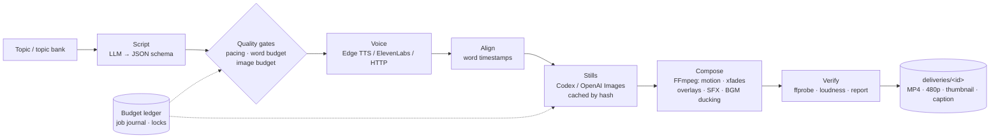

<div align="center">

# 🎬 Codex Stickman Pipeline

**Type a topic, get a finished, narrated stickman explainer video (1080p MP4).**

An end-to-end, resumable Python CLI that orchestrates LLM scripting, AI image generation,
text-to-speech, word-level alignment and FFmpeg rendering, with budget guards, caching and tests.


<sub>Excerpt of a 16-second sample generated end to end by the pipeline ("How a paper airplane glides").</sub>

</div>

---

## Why this project

Faceless explainer videos take hours of manual work: writing, illustrating, recording, timing and editing.
This project automates the whole chain from a single topic line. It was designed and built by the author as an open-source project.

Key engineering ideas:

- **Stage-based pipeline** (`script → voice → align → stills → compose → verify`). Every stage is idempotent and can be re-run on its own.
- **Pluggable providers** behind small interfaces: LLM/image (Codex CLI with your ChatGPT login, OpenAI Images API, any OpenAI-compatible HTTP LLM), voice (Edge TTS, ElevenLabs, generic HTTPS TTS) and alignment (Edge word boundaries or local faster-whisper).
- **Cost safety**: hard caps on image calls per video, pre-spend estimates, a durable cross-project budget ledger, no implicit retries, and no silent fallback to paid providers. Remote calls need an explicit `--live` flag.
- **Resumable & concurrent-safe**: a topic bank with OS-level file locks, a job journal and content-addressed image caching, so a crash resumes without spending quota again.
- **Quality gates**: JSON-schema script validation, word-budget/pacing checks before any spend, and a post-render technical report (duration, loudness, streams).
- **Broadcast-style render**: 1920×1080 @ 30 fps master, Ken Burns camera motion, crossfades, overlays, SFX, music ducking (sidechain) and a −14 LUFS loudness target, plus a 480p copy and an auto-generated thumbnail.

## Features

| | |
|---|---|
| 📝 **AI scriptwriting** | Structured JSON scripts (scenes → visual concepts) with a target length (default 5.5 min, ~145 wpm) |
| 🖼️ **One image per concept** | About one new illustration every 12 s, generated in batched calls with a consistent minimalist style |
| 🎙️ **Narration** | Edge TTS by default (no API key); ElevenLabs or any HTTPS TTS optional |
| ⏱️ **Word-level timing** | Scene and concept cuts aligned to the spoken words |
| 🎞️ **Automated editing** | Camera motion, crossfades, captions/overlays, SFX and background music |
| 📦 **Deliverables** | `master.mp4` (1080p), 480p copy, thumbnail, script, caption with credits, metadata and a technical report |
| 🗂️ **Topic bank & batches** | Queue topics, run `--batch N`, `resume` after interruptions |
| 🧪 **Offline demo & tests** | Procedural demo render plus a pytest suite that needs no network or API keys |

## Architecture



See [docs/ARCHITECTURE.md](docs/ARCHITECTURE.md) for the module map and [docs/HOW_IT_WAS_BUILT.md](docs/HOW_IT_WAS_BUILT.md) for what it is for, how each stage works and how it was built.

## Tech stack

**Python 3.11+** · httpx · Pillow · edge-tts · optional faster-whisper · **FFmpeg / ffprobe** · OpenAI Codex CLI (ChatGPT sign-in) · OpenAI / ElevenLabs / OpenAI-compatible HTTP APIs · pytest

## Quick start

Requirements: Python 3.11–3.13, FFmpeg + ffprobe on `PATH`, Node.js (for the Codex CLI).

```bash
git clone https://github.com/CatbearLang/codex-stickman-pipeline.git
cd codex-stickman-pipeline
python -m venv .venv && source .venv/bin/activate   # Windows: .\.venv\Scripts\Activate.ps1
pip install -e ".[dev]"

# 1) No accounts needed: offline render demo (procedural images + test tones)
python tools/demo.py --out demo-local

# 2) Real video with AI providers
npm install -g @openai/codex
codex login                      # your own ChatGPT account; no tokens are copied
stickman check                   # verifies FFmpeg, Codex, fonts, config
stickman init "My Channel" --topic "How a paper airplane glides"
stickman run --project "My Channel" --live
```

Output lands in `My Channel/deliveries/<id>/`.

## Usage

```bash
stickman init proj --from-script examples/script.json   # start from a hand-written script
stickman script validate examples/script.json
stickman run --project proj --batch 3 --live            # next 3 topics from the bank
stickman resume --project proj --live                   # continue an interrupted job
stickman run --project proj --stage compose             # re-render with existing assets
stickman status --project proj --json
stickman thumbnail --from-image img.png --hook "Why?" --out thumb.png
```

Full reference: [docs/CLI.md](docs/CLI.md).

## Configuration

Each project has a `stickman.toml` (git-ignored). Change it with `stickman config set`:

```toml
[project]  language = "en"  target_minutes = 5.5  aspect = "16:9"
[voice]    provider = "edge"  name = "en-US-AndrewNeural"  speed = 1.0
[images]   provider = "codex-oauth"  size = "1536x1024"  quality = "medium"  reserve_regen = 8
[script]   provider = "codex-oauth"   # or "http" (OpenAI-compatible endpoint)
[align]    mode = "edge-words"        # or "whisper-local"
[render]   fps = 30  width = 1920  height = 1080  lufs = -14.0  bgm = "accralate"  bgm_volume = 0.10
```

Secrets are **never** stored in config; the config loader rejects key-like fields. Optional providers read
environment variables. See [`.env.example`](.env.example) and [docs/PROVIDERS.md](docs/PROVIDERS.md).

## Project structure

```
src/stickman/
├── cli.py, flow.py, pipeline.py   # CLI, orchestration, stage runner
├── scriptx/                       # LLM script generation, prompts, schema, quality gates
├── stills/                        # image providers, batching, cache & budget ledger
├── voice/                         # Edge / ElevenLabs / HTTP TTS + preflight
├── align/                         # word-level timing
├── render/                        # FFmpeg composer and overlays
├── bank.py, manifest.py           # topic bank (locked) and job manifests
├── verify.py, doctor.py           # technical report and environment checks
└── assets/                        # fonts (OFL), SFX, music (CC BY), JSON schema
tests/      # pytest suite (offline)
tools/      # offline demo renderer, release scanner
docs/       # setup, providers, customization, architecture
examples/   # sample script, topic bank, thumbnail
```

## Tests

```bash
pytest -q
```

The suite runs offline with test doubles for every provider. It covers topic-bank locking, config validation,
provider contracts, script schema, pacing and budget gates, image caching, the FFmpeg render path and the
release secret scanner. Current result: **94 passed, 2 skipped** (the skipped tests are author-only provenance checks for the bundled music file).

## Sample output


## Roadmap

- [ ] Vertical 9:16 format for Shorts/Reels
- [ ] Web UI / REST API (FastAPI) on top of the CLI
- [ ] Docker image with FFmpeg preinstalled
- [ ] More languages for narration and scripts (Spanish is already supported)
- [ ] Optional auto-publishing integrations

## Limitations

Images are animated with camera moves; the stick figures are not rigged animation. Generated content
(facts and visuals) should be reviewed by a human before publishing. Remote providers use your own account quota.

## License

[MIT](LICENSE) © Lian Yang. Bundled fonts (SIL OFL 1.1) and music ("Accralate" by Kevin MacLeod, CC BY 4.0)
keep their own licenses. See [THIRD_PARTY_NOTICES.md](THIRD_PARTY_NOTICES.md).

## Author

**Lian Yang**, Informatics Engineer · [@CatbearLang](https://github.com/CatbearLang)

🇪🇸 [Leer en español](README.es.md)
