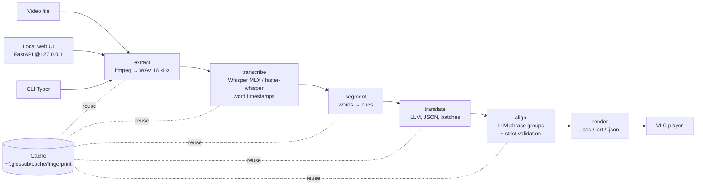

# GlosSub — Architecture & how it was built

## Pipeline

## Modules

| Path | Role |
|---|---|
| `glossub/cli.py` | Typer commands (`run`, `render`, `doctor`, `serve`, …) |
| `glossub/pipeline.py` | Stage orchestration, `--from-stage`, `--force`, skip-if-cached |
| `glossub/stages/` | `extract`, `transcribe`, `segment`, `translate`, `align`, `layout`, `position`, `render` |
| `glossub/providers/` | `Transcriber` / translator protocols; MLX Whisper and OpenAI-compatible LLM implementations |
| `glossub/prompts/*.md` | Translation and alignment prompts (kept out of code) |
| `glossub/cache.py` | Fingerprint = sha256(size + first 64 MB + last 64 MB); atomic writes |
| `glossub/models.py` | Pydantic models for words, cues, groups, jobs |
| `glossub/web/` | FastAPI server + static UI, loopback only |
| `glossub/utils/` | ffmpeg wrapper, timecodes, text, romaji (pykakasi) |

~4.5k lines of Python, plus tests for segmentation, layout, rendering and alignment regressions.

## Cache contract

`audio.wav` → `transcript.json` → `cues.json` → `cues.translated.<lang>.json` → `cues.aligned.<lang>.json`, plus `job.json`. One episode serves several target languages without re-transcribing.

## How it was built

1. **Spec first.** A written product plan (goals, algorithms, non-goals), then a `DECISIONS.md` "contract" that every implementer — human or AI coding agent — must follow. Decisions are not silently changed; deviations are documented.
2. **Verify assumptions before coding.** It was confirmed that mlx-whisper returns monotonic, non-overlapping word timestamps and that the LLM returns valid structured JSON before the pipeline was built on top.
3. **Hardware-driven choices.** On an Apple M2 there is no CUDA, so ASR uses MLX (Metal GPU) with a CPU fallback behind a `Transcriber` protocol.
4. **Milestones with real data.** Each milestone was measured on a real 23.7-min episode; the tables in the README come from those runs.
5. **AI-assisted workflow.** Implementation was driven with AI coding agents using written briefs (`briefs/`), handoff notes and the decisions contract; Lian defined scope, reviewed results visually in VLC and steered fixes.

## Lessons learned (data-driven tuning)

- **Batch size matters:** alignment with 40 cues per batch truncated JSON (colored cues fell from 229 to 130); 20 per batch with concurrency 3 gave 89% in 11 min.
- **Length guards per language:** a 2.5× translation-length guard rejected valid JA→ES output (real median 2.5×); now 6× for ja/zh/ko, 4× otherwise.
- **Fill color, not outline:** colored outlines on white text read as a halo; fill color (`\1c`) is clearly visible.
- **Absolute positioning:** `\an8\pos` per fragment instead of space padding, so each language can use its own font/size without breaking columns.
- **Check tools work, not just exist:** a fake `ffprobe` symlink passed an existence check, so `doctor` now runs `-show_entries`.
